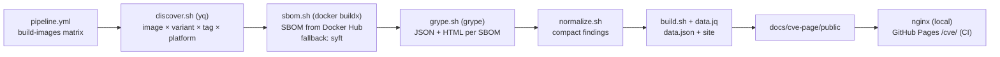

# CVE page

Static vulnerability report for all container images built from `components/`, published with the docs on GitHub Pages: <https://sommerfeld-io.github.io/container-images/cve/>.

The page answers two questions:

- **How vulnerable is each container image?** One block per image with one row per variant: severity counts, total, fixable, known exploited (CISA KEV) and score.
- **Which images are affected by a given CVE?** A search for CVE / GHSA IDs (partial input like `2026-12` works) and package names.

It covers the rolling tags `edge` and `latest` of every image, variant and platform (`linux/amd64`, `linux/arm64`). There is no history: every run rebuilds the page from scratch.

## How it works

The data source is the SBOM that BuildKit attaches to every image on Docker Hub at build time (SPDX JSON, created with syft). The page therefore reports exactly what users pull.



1. `discover.sh` reads the image list from the `build-images` matrix in `.github/workflows/pipeline.yml` (single source of truth). Components without a matrix entry (the deprecated `mkdocs` image) are skipped with a warning.
2. `sbom.sh` resolves the image digest per platform and reads the SBOM attestation with `docker buildx imagetools inspect`. SBOMs are cached by digest in `cache/sboms/`. If an image has no attestation, syft creates the SBOM from the image (marked "SBOM created by page"). If both fail, the image is listed in `work/failed.txt` and marked "not scanned".
3. `grype.sh` updates the grype database once per run and scans every SBOM once, writing the JSON result and grype's own HTML report (`templates/grype-html.tmpl`, vendored unchanged for the grype version in use). If grype detects no distribution from an SBOM that has `distro=` PURLs, the image is scanned by digest instead.
4. `normalize.sh` reduces the grype results to compact, deduplicated findings and `build.sh` joins them into one `data.json` next to the static site (`site/`). All aggregates are computed in the browser.

All tools (yq, docker CLI with buildx, syft, grype, nginx) run as pinned containers from the root `docker-compose.yml` (`cve-*` services), as the calling user. The GitHub workflow `.github/workflows/docs.yml` ("Pipeline: Docs") runs the same tasks and publishes the CVE page together with the zensical docs: every night at 04:00 UTC and after every run of "Pipeline: Commit + Test" on `main` and of "Pipeline: Release".

## Usage

Requirements: Docker with Compose, [Task](https://taskfile.dev), `bash` and `jq`. Registry access uses your Docker Hub login: `scripts/lib.sh` writes a temporary Docker config for the tool containers with the credential from `~/.docker/config.json` (also when it comes from a credential helper, e.g. the one VS Code injects into dev containers) and removes it afterwards. The images are public, so a login is optional (but avoids Docker Hub rate limits).

The tool containers run as your UID/GID. This works in the repository's devcontainer, where `.devcontainer/post-start.sh` restarts the docker-in-docker containerd with umask `0022`. The hardened `UMASK 027` of `sommerfeldio/devcontainer` would otherwise create every container's root directory with mode `0750`, which breaks containers running as a non-root user.

The tasks are defined in `docs/taskfile.yml` (included in the root `taskfile.yml`) and run from the project root:

| Task                                                                          | Does                                                                                                                                                 |
|-------------------------------------------------------------------------------|------------------------------------------------------------------------------------------------------------------------------------------------------|
| `task docs:cve:scan`                                                          | discover → SBOM (Docker Hub, fallback syft) → grype. Options: `PARALLEL=<n>` (default 4), `FORCE=true` (ask Docker Hub again for all tags and SBOMs) |
| `task docs:cve:build`                                                         | build the page into `docs/cve-page/public`                                                                                                           |
| `task docs:cve:serve`                                                         | serve the page on <http://127.0.0.1:3081> in the foreground, Ctrl+C stops (builds first if missing)                                                  |
| `task docs:cve:kill`                                                          | stop a running scan and remove all CVE page containers (incl. one-off `run` containers)                                                              |
| `task docs:sbom:get IMAGE=<component> TAG=<tag>[-suffix] PLATFORM=<platform>` | save the SBOM of an image from Docker Hub as `<image>-<tag>-<arch>.spdx.json` in the current directory                                               |

```bash
task docs:cve:scan && task docs:cve:build && task docs:cve:serve
task docs:sbom:get IMAGE=devcontainer TAG=latest-go PLATFORM=linux/arm64
```

The first scan downloads the grype database (~3 GB unpacked) to `docs/cve-page/cache/grype/`.

Docker Hub is only asked for what is not present locally (every manifest request counts against the Docker Hub pull rate limit):

- the image index of each tag (tag → digest per platform) is kept in `cache/index/` and reused by later runs,
- SBOMs are kept by image digest in `cache/sboms/`,
- the tool images are pulled only when missing (`pull_policy: missing`).

So after the first successful scan, local scans work without Docker Hub, but they do not notice new `edge`/`latest` images. Run `task docs:cve:scan FORCE=true` to check Docker Hub again (if Docker Hub is not reachable, the local copies are used with a warning). CI does not cache `cache/index/`, so every workflow run resolves the current images.

## Score

Score = grype's risk value (0–100): severity (CVSS / rating) × probability of exploitation in the next 30 days (EPSS); CVEs in the CISA list of known exploited vulnerabilities (KEV) count as certain and get a bonus. Higher means fix first - images and variants show the score of their highest-scoring CVE.

## Files

| Path         | Content                                                      | Git     |
|--------------|--------------------------------------------------------------|---------|
| `scripts/`   | `scan.sh`, `build.sh`, the single steps, `data.jq`, `lib.sh` | tracked |
| `templates/` | grype's HTML template and the grype version it belongs to    | tracked |
| `site/`      | `index.html`, `assets/` (no build step, no CDN)              | tracked |
| `work/`      | image list, SBOMs, grype results, `failed.txt`               | ignored |
| `cache/`     | grype DB, SBOMs by digest, temp files                        | ignored |
| `public/`    | built site                                                   | ignored |

## Updating tool versions

The tool images in `docker-compose.yml` are pinned and updated by Dependabot. grype's HTML template must match the grype version. When `anchore/grype` is bumped, `task docs:cve:scan` fails with the commands to update `templates/grype-html.tmpl` and `templates/grype-version.txt`. The grype version in the SBOM section of the component READMEs should be bumped as well.

The grype reports (`reports/*.html`) are grype's own, unchanged template, which loads DataTables from `cdn.datatables.net`. The CVE page itself loads nothing from a CDN.
